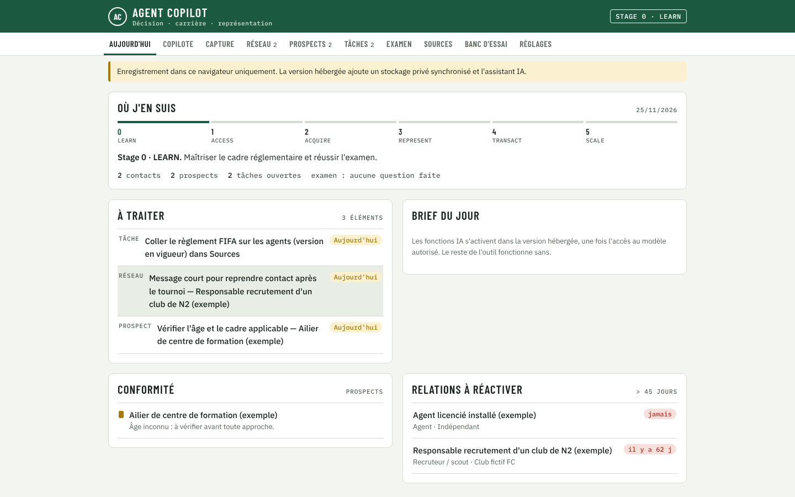
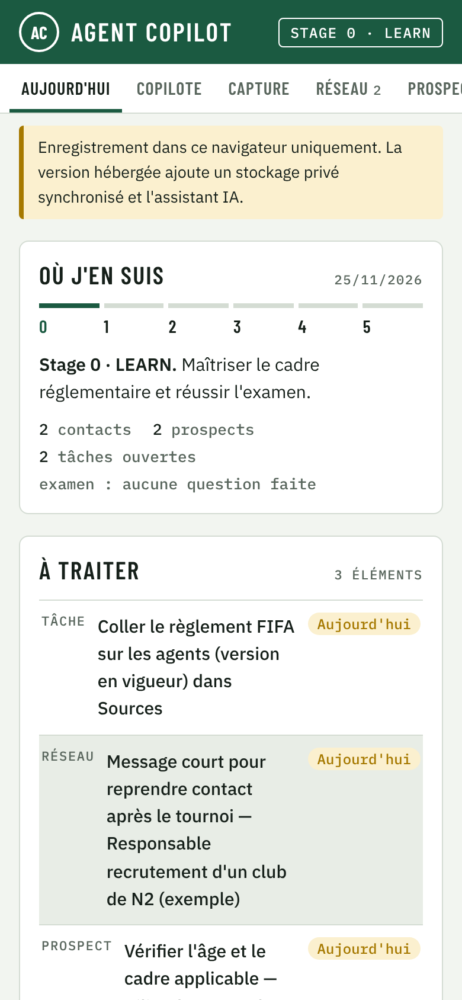

# Agent Copilot — le copilote de l'agent de joueurs

[](https://github.com/Skysaks/AGENT-COPILOT/actions/workflows/ci.yml)

> **EN** — A working copilot for football agents: prepare the FIFA agent exam from the official texts, run your network and prospects, and get recommendations where every fact is labelled (confirmed, estimate, inference, rumour, unknown).

**Démonstration** : [skysaks.github.io/AGENT-COPILOT](https://skysaks.github.io/AGENT-COPILOT/) · fichier autonome : [`dist/agent-copilot.html`](dist/agent-copilot.html) (à télécharger et ouvrir, hors ligne, sans installation).



> © 2026 Florian Iglesias — Tous droits réservés. Dépôt public à titre de portfolio uniquement : aucune licence n'est concédée. Voir [LICENSE](LICENSE).

## Le principe

Le métier d'agent de joueurs mêle droit (règlement FIFA, mineurs, rémunération), relationnel et décisions rapides sur des informations incomplètes. Les outils génériques mélangent faits et rumeurs ; un CRM ne dit pas quoi faire ensuite. Agent Copilot part d'une règle : **ne jamais fabriquer**. Chaque information porte un statut, chaque analyse se termine par une seule action suivante, proportionnée au stade de l'utilisateur.

Le parcours suit six stades — **Learn → Access → Acquire → Represent → Transact → Scale** — et l'interface s'adapte au stade courant (au début : réussir l'examen et construire son réseau).

## Fonctionnalités

- **Aujourd'hui** : tâches du jour, conformité des prospects (âge inconnu ou mineur → vérification avant toute approche), relations à réactiver après 45 jours, brief du jour.
- **Copilote** : fils de conversation par mode — libre, joueur, club, offre, prospection, rendez-vous, réseau, message, examen, juridique, décision. Les réponses distinguent *FACTS / UNKNOWN / INFERENCES / OPTIONS / RECOMMENDATION* et se terminent par *NEXT BEST ACTION*.
- **Statut de chaque information** : confirmée (source et date), fournie par l'utilisateur, estimation, inférence, rumeur, inconnue.
- **Capture** : une note libre devient contacts, prospects et tâches, à valider avant enregistrement.
- **Réseau, prospects, tâches** : fiches éditables, suppression avec confirmation.
- **Examen** : questions d'entraînement générées depuis les textes officiels collés dans *Sources*, avec la référence d'article exigée, un chronomètre et le suivi des résultats.
- **Banc d'essai** : trois cas pièges (rumeur de mercato, prospect mineur, offre incomplète) rejoués contre le copilote, chacun avec quatre critères de comportement à cocher.
- **Réglages** : stade, positionnement, disponibilité, langue de travail, délai de relance ; export et import JSON de toutes les données ; consignes de l'assistant consultables.

| Ordinateur | Téléphone |
|---|---|
|  |  |

## Deux modes

| | Démonstration (ce dépôt, GitHub Pages) | Version hébergée |
|---|---|---|
| Données | dans ce navigateur (`localStorage`), exemples fictifs à charger | espace privé synchronisé, par utilisateur |
| Copilote, capture, examen, banc d'essai | désactivés | actifs |
| Réseau | aucune requête | API de l'hébergeur uniquement |

Détail : [docs/ARCHITECTURE.md](docs/ARCHITECTURE.md).

## Construire et tester

Node 22 (voir `.nvmrc`). Aucune dépendance d'exécution ; Playwright sert uniquement aux tests.

```bash
npm ci
npm run dev        # http://localhost:5173, reconstruit à chaque modification de src/
npm run build      # src/ → dist/agent-copilot.html (fichier unique, polices embarquées)
npm run verify     # aucune ressource externe, budget de taille, aucune donnée personnelle
npm test           # tests d'intégrité (node:test) + parcours bureau et mobile (Playwright)
npm run captures   # régénère docs/captures/
```

## Structure du dépôt

```
src/
  index.html            gabarit : coquille de l'interface, ordre des feuilles et des modules
  styles/               00-socle, 00-polices, 01-base, 02-copilote, 03-examen
  js/
    01-consignes.js     consignes de l'assistant, stades, modes, cas du banc d'essai
    02-utilitaires.js … 07-contexte.js   état, stockage, rendu, contexte envoyé au modèle
    08-vue-… 12-vue-…   une vue par onglet
    13-actions-ia.js    copilote, brief, capture, examen, banc d'essai
    14-exemples.js, 15-actions.js
  fonts/                Barlow Condensed, IBM Plex Sans, IBM Plex Mono (woff2, sous-ensemble latin)
dist/agent-copilot.html fichier construit, autonome (≈ 320 Ko)
scripts/  tests/  docs/
```

## Choix techniques

- **Les consignes de l'assistant sont du code**, versionnées dans `01-consignes.js` et lisibles dans *Réglages* : le comportement du copilote se relit et se teste comme le reste.
- **Le contexte envoyé au modèle est construit, pas copié** : profil, sources et fiches sont résumés (`07-contexte.js`), les fils sont bornés (40 messages, 180 000 caractères) pour rester dans la fenêtre du modèle.
- **Banc d'essai intégré** : les cas pièges vérifient les règles qui comptent (ne pas confirmer une rumeur, traiter l'âge d'un prospect avant la stratégie, lister les termes manquants d'une offre).
- **Un seul fichier HTML, sans framework** : s'ouvre hors ligne, se dépose chez n'importe quel hébergeur statique.

## Limites connues

1. **Sans version hébergée, pas d'IA** : la démonstration montre l'organisation (réseau, prospects, tâches, examen), pas les réponses du copilote.
2. **Le copilote ne vérifie pas les sources lui-même** : une règle n'est « confirmée » que si son texte a été collé dans *Sources* ; sinon elle reste à vérifier.
3. **Pas un conseil juridique** : le mode juridique signale quand l'avis d'un avocat ou d'un fiscaliste est nécessaire.
4. **Tests automatiques sur Chromium** (bureau et mobile émulé) ; Safari et Firefox ne sont pas couverts par la CI.

## Sécurité et confidentialité

En démonstration, les données restent dans le navigateur. Le copilote ne reçoit que le résumé utile à la question, et ses consignes lui interdisent de demander des données inutiles à la décision (santé comprise). Signalement des failles : [SECURITY.md](SECURITY.md).

## Licence

© 2026 Florian Iglesias — Tous droits réservés ([LICENSE](LICENSE)). Les polices embarquées restent sous SIL Open Font License 1.1 ([docs/licences/](docs/licences/)). Contributions : [CONTRIBUTING.md](CONTRIBUTING.md).
