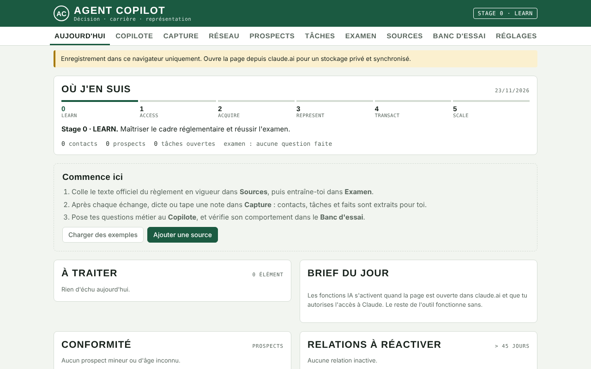

# AGENT-COPILOT

Copilote de travail pour agent de joueurs de football : comprendre une situation, décider, et choisir l'action suivante.

## Fonctionnalités

- Tableau de bord du jour : échéances, conformité des prospects, relations à réactiver, progression par étapes
- Copilote par mode : joueur, club, offre, prospection, rendez-vous, réseau, message, examen, juridique, décision
- Chaque information porte un statut (confirmée, fournie, estimation, inférence, rumeur, inconnue)
- Réseau, prospects (contrôle de l'âge avant toute approche), tâches, capture de notes
- Préparation à l'examen d'agent à partir des textes officiels fournis, et banc d'essai du comportement du copilote

## Lancer

Ouvrir `index.html`.

## Fonctions connectées

La synchronisation privée et les fonctions d'IA s'activent lorsque la page est publiée comme artefact sur claude.ai, qui fournit un stockage privé, l'identité de l'utilisateur, l'accès à un modèle de langage et les téléchargements. Ouverte directement dans un navigateur, l'application bascule en mode local : les données sont enregistrées dans le navigateur et les fonctions d'IA sont désactivées.

## Technique

Application monofichier en JavaScript sans dépendance.

## Statut

Fonctionnel.

## Droits

© 2026 Florian Iglesias – Tous droits réservés. Code publié à titre de présentation : aucune licence d'utilisation, de copie ou de redistribution n'est accordée.
